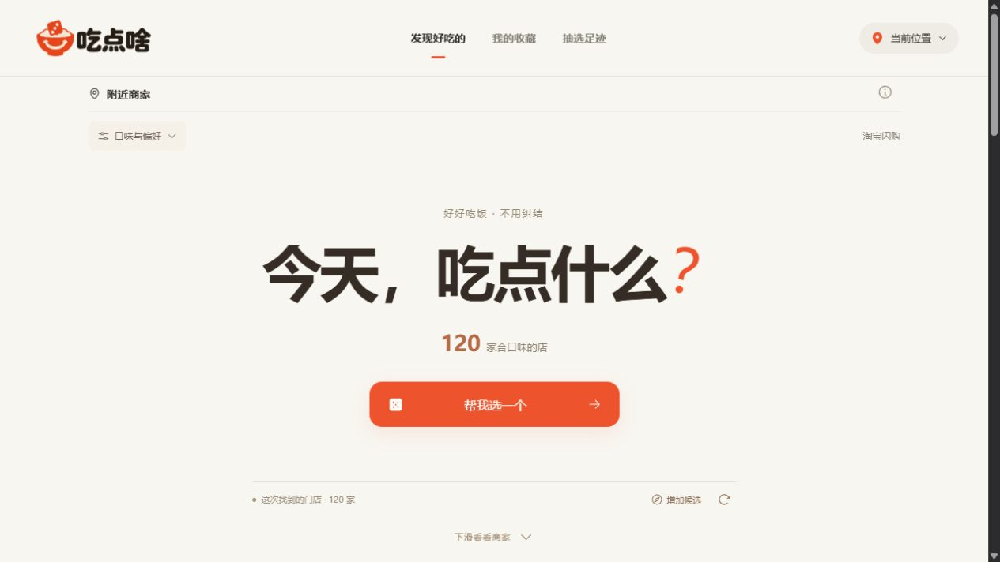
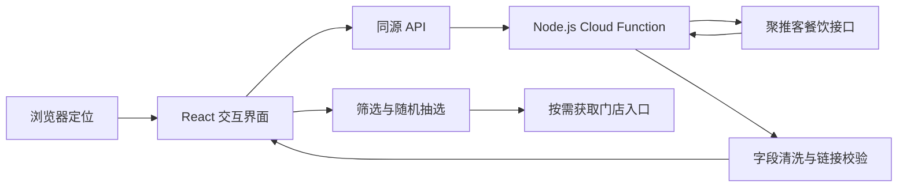

# 吃点啥 · 附近餐饮决策工具

基于浏览器定位、附近商家检索与随机抽选的 Web 应用。本仓库包含可运行源码及技术报告，重点说明有状态分页、缓存恢复、请求取消和服务端凭证隔离的实现。

打开首页后请求位置权限，定位成功即查询附近候选；用户可以按口味和店名筛选，也可以随机选一家，再进入平台查看菜单。结果来自聚推客返回的淘宝闪购推广门店，**不代表周边全部餐饮商家**。



## 技术路线



| 层级 | 方案 | 作用 |
| --- | --- | --- |
| 界面 | React 19、Motion、Phosphor Icons | 响应式布局、抽选动画、弹窗与反馈 |
| 构建 | Vite 7、esbuild | 浏览器资源构建、云函数打包 |
| 服务端 | Node.js、Web Request/Response | 输入校验、来源检查、限流、数据裁剪 |
| 上游连接 | Node HTTPS + IPv4 | 服务端请求外部餐饮接口 |
| 状态 | React state、sessionStorage、localStorage | 候选池与本机偏好分层保存 |
| 验证 | Node test runner、jsdom | 逻辑、API、浏览器组件与故障场景测试 |
| 部署 | Tencent EdgeOne Makers / Cloud Functions | 静态资源和同源 API 部署 |

完整说明见 **[技术报告](docs/TECHNICAL_REPORT.md)**，包含架构、关键算法、API、工程取舍、验证结果与适用边界。

## 功能

- 首页自动请求定位，拒绝权限时显示说明及重试入口。
- 每批最多查询 6 页、120 家；最多 25 页、500 家，按门店 ID 去重。
- 已加载结果可以立即筛选、抽选；后续页失败保留已有候选。
- 收藏、抽选足迹、黑名单保存在当前浏览器。
- 分享只携带门店标识和展示字段，门店跳转链接由服务端重新获取。
- 支持手机与桌面布局，弹窗支持浏览器返回键关闭。

## 本地运行

建议使用 Node.js 24 与 npm。依赖版本以 `package-lock.json` 为准。

```bash
npm ci
```

将 `.env.example` 复制为 `.env.local`，填入自己申请的 `JUTUIKE_API_KEY`，然后运行：

```bash
npm run dev
```

访问 `http://127.0.0.1:8787`。未配置密钥仍可运行测试、构建及查看界面，但不能查询真实商家。真实定位需要浏览器支持和位置授权；远程站点须使用 HTTPS。

```bash
npm test
npm run build
npm start
```

`npm start` 用于在本机检查构建产物，默认只监听回环地址。测试使用模拟接口与公开测试坐标，不依赖真实密钥。

## 部署

1. 在自己的 EdgeOne 项目配置服务端环境变量 `JUTUIKE_API_KEY`。
2. 将 `cloud-functions/api/[[path]].js` 中的 `https://food.example.com` 替换为自己的正式 HTTPS Origin，仅包含协议、域名和必要端口，不带路径或末尾斜杠。
3. 运行 `npm test` 和 `npm run build`，发布 `dist/`。其中包含静态资源和打包后的云函数。
4. 用正式浏览器来源测试 `/api/nearby` 和 `/api/store`；不要只测试没有 `Origin` 的请求。

云网关可能将请求 URL 改为内部地址，因此服务端使用固定的正式 Origin 校验来源，不从转发头推导白名单。示例域名是占位配置，必须在独立部署时修改。

## 验证与边界

- 自动化测试覆盖定位授权、分页游标、取消请求、缓存恢复、随机抽选、来源校验和字段隔离；运行结果见 [验证记录](docs/VALIDATION.md)。
- 界面截图来自公开测试坐标下的真实接口验收，不是用户定位记录。手机布局截图见 [mobile.png](docs/images/mobile.png)。
- 数量上限是客户端请求边界，不保证每个地区返回 500 家。分类依据店名规则，关键词只筛选已加载候选。
- 不提供经核实的距离、价格、评分、实时营业状态或配送承诺。站内不下单、不收款，最终信息以平台为准。

## 仓库说明

此公开快照不包含运营域名、云账户标识、真实密钥、本机路径、历史部署日志、备份或用户数据。与运行无关的过程记录未纳入仓库。源代码提交使用项目级匿名署名。

图片来源记录位于 `public/images/sources.json` 和 `public/images/more-sources.json`；第三方素材说明见 [素材说明](docs/ASSETS.md)。本仓库未附加软件许可证，公开可阅读不等于对所有代码、品牌及素材授予任意再分发许可。
