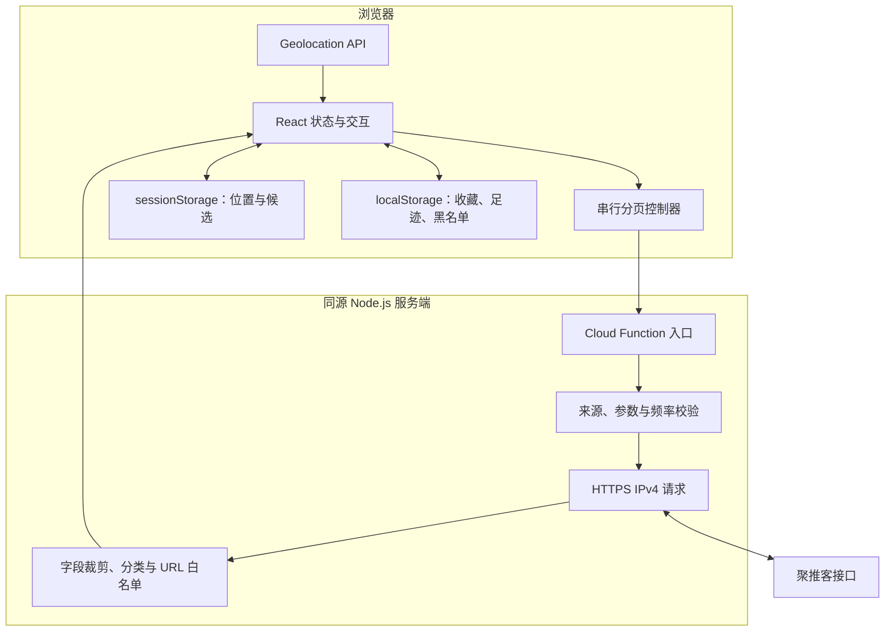
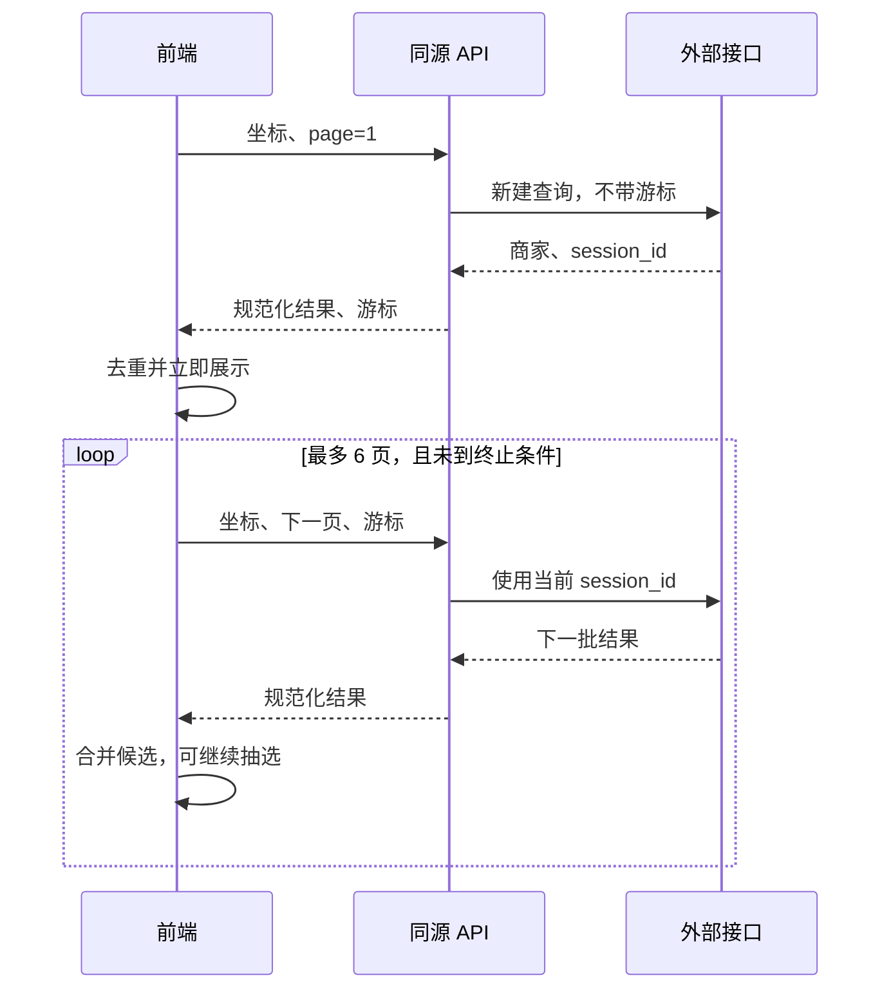

# 吃点啥：基于位置与有状态分页的餐饮决策应用

## 摘要

本项目将“附近有什么可选”与“从中选一家”组织为连续的浏览器交互流程：获取位置，加载候选，筛选与抽选，按需获取门店入口。前端采用 React，服务端以 Node.js 云函数代理餐饮接口。系统不训练推荐模型，不构建用户画像；核心是受约束的候选集与可解释的随机选择。

工程重点是外部接口的会话语义与浏览器生命周期之间的协调。上游游标随调用推进，网络失败可能产生不确定的消费状态，因此分页请求采用串行调用、不自动重放游标、部分结果保留和重新建会话的策略。位置及候选只在标签页内短期暂存，收藏等偏好则独立保存。

本报告以仓库源码为依据，区分可重复的自动化验证、已有浏览器验收与尚未覆盖的真实设备行为。

## 1. 目标与范围

应用降低选择一餐时的操作成本，提供定位、附近候选、分类、店名过滤、随机选择、收藏、足迹、黑名单及分享。首页不使用预置灵感菜单替代真实附近结果。

商家数据来自聚推客的淘宝闪购推广门店接口。平台覆盖决定候选范围，系统不声称检索周边全部餐饮，也不把推广关系或佣金高低用作抽选权重。门店详情链接可能属于推广入口；支付、优惠兑现、营业情况及配送范围由外部平台确认。

## 2. 系统结构

| 模块 | 源文件 | 职责 |
| --- | --- | --- |
| 交互入口 | `src/main.jsx` | 定位、候选展示、偏好、抽选及详情状态 |
| 定位 | `src/location.mjs` | 快速定位、高精度回退与错误解释 |
| 分页 | `src/nearby.mjs`、`src/search-options.mjs` | 批次、页数和串行间隔 |
| 缓存 | `src/nearby-cache.mjs` | 位置匹配、TTL、持久化字段裁剪 |
| 请求 | `src/api-client.mjs` | 超时、取消及可配置重试 |
| 业务逻辑 | `src/logic.mjs` | 筛选、随机与分享输入处理 |
| 弹窗历史 | `src/modal-history.mjs` | 弹窗与浏览器返回栈协调 |
| API | `server/api.mjs` | 参数校验、接口映射、数据规范化 |
| 云适配 | `server/cloud-handler.mjs` | 请求对象、环境变量和客户端 IP 适配 |
| 传输 | `server/https-fetch.mjs` | HTTPS IPv4、取消、响应大小约束 |
| 部署入口 | `cloud-functions/api/[[path]].js` | 固定正式 Origin 与云函数导出 |

## 3. 技术选择

React 负责界面状态与组件生命周期，Motion 提供抽选与弹窗动画。Vite 构建浏览器资源；esbuild 将服务端入口打包为 Node.js ESM 云函数。前端与 API 使用同源路径，避免在客户端分发上游凭证。

本地开发服务将 Vite 中间件与相同的 API 适配层组合，减少开发与云部署之间的业务逻辑差异。云端调用使用 Node HTTPS，显式选择 IPv4；该选择源于既有环境中的传输验收，不应推广为所有网络故障的通用解决方法。

数据量上限为 500 个候选，无需数据库即可完成当前会话。采用浏览器存储的代价是偏好无法跨设备同步，清理浏览器数据会丢失记录。当前范围不引入账户系统、服务端用户档案或协同状态。

## 4. 定位与页面生命周期

首页挂载时主动调用浏览器定位，位置权限仍由浏览器控制。首次请求使用低精度模式，超时 10 秒，可接受最多 2 分钟前的位置。仅在位置不可用或超时后进行一次高精度尝试，超时 15 秒且不接受缓存位置。权限被拒绝时直接结束，不反复触发请求。

定位成功更新位置状态，随后启动附近检索。请求编号避免较早的定位结果覆盖较新的操作。位置变化、离开查询视图或清空候选时，取消正在进行的网络请求，并使旧响应失效。

已有有效缓存时可先恢复候选，再重新定位。两次位置相距不超过 150 米时复用当前位置及其缓存，降低 GPS 小幅漂移造成的重复查询。该阈值仅用于缓存匹配，不是商家搜索半径，也不用于显示门店距离。重新定位失败且仍保留旧位置结果时，界面明确提示结果来自上次位置。

## 5. 分页与错误恢复

| 参数 | 当前值 | 含义 |
| --- | --- | --- |
| 每页数量 | 20 | 上游分页大小 |
| 每批页数 | 最多 6 | 首批及增加候选的批次大小 |
| 累计页数 | 最多 25 | 单次查询的边界 |
| 候选总量 | 最多 500 | 去重后的保存上限 |
| 页间等待 | 500 ms | 串行请求的最小等待间隔，不含网络耗时 |
| 前端请求超时 | 20 s | 单次 API 请求超时 |
| 上游超时 | 15 s | 服务端外部请求超时 |

游标不是可任意重放的页码。外部接口按调用推进会话，若请求已被上游处理但响应丢失，重试同一游标可能跳过数据。因此附近请求显式禁用自动重试，不共享首批游标，也不将游标写入浏览器持久化存储。

每页成功即按门店 ID 合并，后续页失败时保留已到达的数据并停止后续调用。用户主动重新连接时从第一页新建会话，再去重合并。上游提前结束、无可用游标、达到页数或候选上限都会终止加载。已有结果可在后台加载期间继续参与抽选。

通用请求工具支持有限重试，但业务调用的重试策略独立配置；不能仅因工具存在重试分支就认定分页会被重放。

## 6. 缓存与本机数据

| 数据 | 保存位置 | 生命周期与约束 |
| --- | --- | --- |
| 当前交互、请求游标 | 页面内存 | 页面重载后不恢复游标 |
| 位置与候选 | `sessionStorage` | 最多 4 组，30 分钟有效期，每组最多 500 家 |
| 收藏 | `localStorage` | 最多 100 条，无跨设备同步 |
| 抽选足迹 | `localStorage` | 新增记录时保留最近 30 条 |
| 黑名单 | `localStorage` | 最多 10,000 条标识与名称 |
| 门店入口缓存 | 页面内存 | 同一门店 5 分钟内复用 |

恢复会话缓存时清除游标，并将“还有更多”状态置为不可直接续取，避免旧会话被继续消费。浏览器拒绝存储或写入失败时保留页面内存状态，不使主流程崩溃。界面提供清空位置候选、收藏足迹及管理黑名单的入口。

位置会发送到本站 API，再由服务端发给餐饮接口用于查询。代码没有实现位置数据库；这不表示托管平台或上游服务绝不会记录网络访问。分享内容不包含位置、密钥或上游游标。

## 7. 筛选与随机抽选

筛选在已加载候选上执行。分类通过店名规则粗略判断，关键词匹配店名；系统不将本地筛选描述为外部平台全量搜索。

随机选择使用 `Math.random()`，在当前筛选结果中排除黑名单。当候选多于一个时，排除上一次抽中的门店，再在剩余候选中等概率选择。它实现的是“剩余可选集合内等概率”，并不意味着对平台全部商家等概率。单一候选允许重复，空集合禁用抽选。

抽选动画先确定最终结果，再显示滚动名称，不因动画时长改变结果。佣金等字段不进入前端候选结构，因而不参与抽选。此方案适合日常决策，不用于需要可审计随机性或密码学随机性的场景。

## 8. API 与数据约束

| 接口 | 请求 | 响应摘要 |
| --- | --- | --- |
| `GET /api/config` | 无 | 提供方、是否配置、应用名与版本 |
| `POST /api/nearby` | `lat`、`lng`、`page`，后续页带 `sessionId` | 商家数组、页码、游标、是否可继续及数据说明 |
| `POST /api/store` | `shopId` | 经白名单校验的平台入口、平台名、推广标记 |

第一页不允许传入游标，后续页要求合法游标；坐标必须是有限数值且位于经纬度范围内。门店 ID 和游标限制字符集与长度。API 文本体限制为 2,048 字符，本地 HTTP 入口另设 4,096 字节读取上限。

服务端只保留门店 ID、名称、分类、合规图片 URL、模糊销量及平台字段，不向客户端返回密钥、佣金或未经验证的价格、评分、距离。图片和门店入口分别使用域名白名单，拒绝嵌入凭证和非 HTTP(S) 协议的地址，输出升级为 HTTPS。

请求 Origin 必须匹配部署入口配置的正式 Origin。缺少 Origin 的请求仍可进入业务处理，所以这项检查是浏览器跨站防护，不是身份认证。限流按单个函数实例、客户端 IP 统计，每分钟最多 35 次；它不能替代跨实例全局限额或账户权限控制。部署时需要保证客户端 IP 由可信网关提供。

上游连接、格式及业务错误映射为受控提示，不透传原始上游响应。HTTPS 传输层还限制单次响应体不超过 2 MiB。

## 9. 构建与交付

`npm run build` 先生成浏览器静态文件，再将云函数及服务端依赖打包到 `dist/cloud-functions/api/`，并复制响应头配置。真实密钥只通过服务端环境变量提供，不使用 `VITE_` 前缀注入前端。

公开仓库使用示例 Origin，部署者需要替换为自己的域名。测试中的域名也是保留用途的示例值。发布验收应检查网页和 JS/CSS 是否为预期构建，并带正式浏览器 Origin 调用 API；仅有部署命令成功或首页 HTTP 200 不足以证明查询链路可用。

## 10. 验证结果及限制

可重复的自动化测试覆盖随机、分享解析、参数校验、数据裁剪、来源检查、HTTPS 适配、会话隔离、分页取消、旧结果保留、定位拒绝及不安全上下文。公开副本的运行环境、测试数量和构建结果集中记录于 [验证记录](VALIDATION.md)。

已有浏览器验收使用公开测试坐标模拟定位成功，调用真实接口自动加载 120 家，并检查桌面及 390×844 手机布局。该证据证明模拟定位到真实商家查询的链路，不能证明所有手机均能成功获取 GPS，也不能代表持续可用性、全地区覆盖或实际配送能力。

尚未进行多区域压力测试、全局并发容量评估或所有移动端原生 App 唤起验证。当前不提供账号同步、精确配送半径、营业状态或完整商家地图。未来如需扩展，应优先补充稳定的地点选择、可信网关与共享限流，再根据真实需求引入同步存储和更准确的分类。
